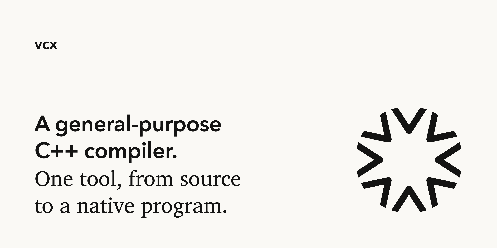

<p align="center">
  
</p>

`vcx` is a C++ compiler written in Go. One tool takes a program from source to a
native executable, with its own preprocessor, parser, analyzer, code generator
and linkers. It also builds the native code in every
[Vertex](https://github.com/vertex-language/vertex-language) package. The command
is `v++`.

[Command line](docs/cli.md) ·
[Targets](docs/targets.md) ·
[Architecture](docs/architecture.md) ·
[Vertex](https://github.com/vertex-language/vertex-language)

## Getting started

`vcx` builds with Go from a set of sibling checkouts:

```
mkdir vertex && cd vertex
for repo in vcx ir asm air amd64 arm64 i386 amdgpu ptx elf macho pe; do
    git clone https://github.com/vertex-language/$repo
done
cd vcx && go build -o ~/bin/v++ ./cmd/v++
```

Then compile a program:

```
v++ run main.cpp
v++ build -o app main.cpp
v++ build -c -o main.o main.cpp
```

`vcx` reads the platform's system headers and links against its libraries.
`v++ env` shows what it found.

## Languages

`vcx` compiles C++20, C++23 and C++26, with C++23 as the default. It also
compiles Objective-C++ and [GPU languages](docs/gpu.md).

## Commands

| | |
| :--- | :--- |
| `v++ run` | Build a program and run it |
| `v++ build` | Compile and link, or stop earlier with `-c` or `--emit` |
| `v++ check` | Preprocess, parse and analyze |
| `v++ layout` | Print the memory layout of every class |
| `v++ symbols` | Print the object-file name of every definition |
| `v++ ast`, `v++ tokens` | Print the syntax tree or token stream |
| `v++ env` | Print the target and include paths |

## Targets

| | |
| :--- | :--- |
| `aarch64-macos`, `x86_64-macos` | Mach-O |
| `x86_64-linux`, `aarch64-linux` | ELF |
| `x86_64-windows` | PE/COFF |
| `x86_64-elf`, `i386-elf` | ELF, bare metal |

The host is the default. Choose another with `-target`. A target's headers and
libraries must be available to compile and link against it.

## As a Go library

Every stage of the compiler is a Go package, and the source can come from memory:

```go
c := &vcx.Compiler{Target: "x86_64-linux", Std: vcx.Cxx23}

src := []byte("struct Point { int x; int y; };")
records, _, err := c.Layout(vcx.Text("point.cpp", src))
if err != nil {
	log.Fatal(err)
}
for _, r := range records {
	fmt.Println(r.Name, r.Size) // Point 8
}
```

## Status

`vcx` is in active development. Classes, templates, concepts, `constexpr` and
exceptions compile and run. So do `<vector>`, `<string>`, `<optional>`,
`<memory>`, `<algorithm>` and `<functional>` from the system's standard library
on macOS. `<map>` and `<iostream>` do not compile yet.

## Testing

```
go test ./...
```

[`tests/`](tests/README.md) is a ladder, one small program per file, in the order
features build on each other. Every program is built by `vcx` and by a reference
compiler, and the results are compared. A disagreement is a bug in `vcx`.

## Documentation

- [Command line](docs/cli.md)
- [Targets and ABIs](docs/targets.md)
- [Architecture](docs/architecture.md)
- [GPU languages](docs/gpu.md)
- [C++ grammar](docs/cpp_grammar.md)
- [Tests](tests/README.md)

## License

[MIT](https://github.com/vertex-language/vsc/blob/main/LICENSE)
